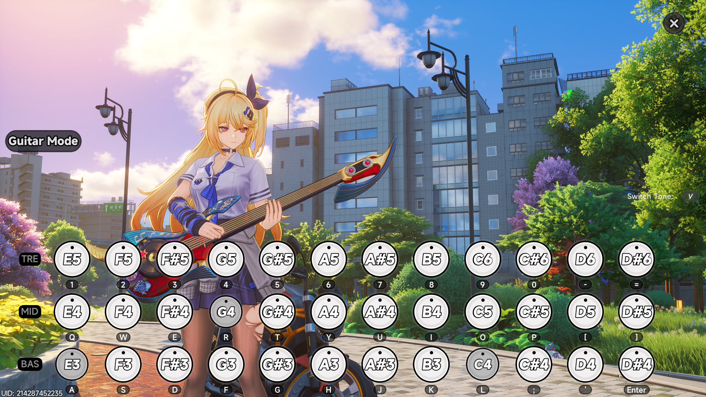

# NTE Guitar Auto-Player

**English** | [Español](#español)

Plays MIDI files automatically on the in-game **Guitar Mode** instrument (36 keys, E3 to D#6) of *Neverness to Everness*, by sending the matching keyboard keys.



**Download / Descargar:** [PianoPlayer_EN.zip (English)](https://github.com/ezequielaragon/nte-guitar-autoplayer/raw/main/download/PianoPlayer_EN.zip) · [PianoPlayer_ES.zip (Español)](https://github.com/ezequielaragon/nte-guitar-autoplayer/raw/main/download/PianoPlayer_ES.zip)

---

## English

### Features

- **Song menu**: lists every `.mid` file in the program's folder. Just pick a number.
- **Easy modes with a recommendation**: melody only, melody + accompaniment, full band, all notes, or custom.
- **Automatic melody detection** in multi-instrument MIDIs, plus an accompaniment track when one helps.
- **No long silences**: when the chosen tracks go quiet, another instrument fills the gap.
- **Clean sound**: notes outside the 3 rows are moved into range by octaves, and duplicate or clashing notes are removed.
- **Hold notes**: each key stays pressed as long as the note lasts in the MIDI (can be turned off).
- Drums are ignored automatically. Stop at any time with **ESC**.

### Quick start

1. Download **[PianoPlayer_EN.zip](https://github.com/ezequielaragon/nte-guitar-autoplayer/raw/main/download/PianoPlayer_EN.zip)** (English) or **[PianoPlayer_ES.zip](https://github.com/ezequielaragon/nte-guitar-autoplayer/raw/main/download/PianoPlayer_ES.zip)** (Spanish) and extract it. You get the `.exe` and an empty `midis` folder.
2. Download MIDI files from **[Online Sequencer](https://onlinesequencer.net/sequences)** and put them in the `midis` folder.
3. Double-click the `.exe` and accept the administrator prompt. Without admin rights, the game ignores the keys.
4. Pick a song number, then a mode.
5. You have **5 seconds** to switch to the game with **Guitar Mode** open.
6. Press **ESC** to stop. When the song ends, you are back at the song list.

```
PianoPlayer_EN.exe
midis/
    your-song.mid
    another-song.mid
```

If the `midis` folder is missing, the program creates it the first time you open it.

### Modes

After picking a song you will see something like this:

```
[1] Melody only              - track 3 (Grand Piano), one note at a time, no silences
[2] Melody + accompaniment   - track 3 + track 1 (Distortion Guitar), up to 3 notes   <- RECOMMENDED
[3] Full band, tidy          - all tracks, melody on top, up to 3 notes
[4] All notes                - the whole MIDI unfiltered (may sound messy)
[5] Custom                   - choose tracks, notes, speed and pitch
[M] Hold notes: ON (each note lasts as long as in the MIDI)  -> type M to toggle
```

Single-instrument MIDIs show *Melody only / Melody + bass / Balanced / All notes / Custom* instead.

**Enter** goes back to the song list. It never picks a mode for you.

### Shortcut extras

Add options after the mode number, separated by commas:

| You type | Result |
|---|---|
| `2` | Mode 2 as is |
| `2,1` | Mode 2, max 1 note per chord |
| `2,T` | Mode 2, all notes |
| `2,12` | Mode 2, one row higher (one octave) |
| `2,-12` | Mode 2, one row lower |
| `2,1,-12` | 1 note and one row lower (any order) |

### Custom mode

Asks for:
- **Tracks**: e.g. `3` or `3,1`, or `T` for all.
- **Notes per chord**: `1` to `11`, or `T` for all.
- **Speed**: `1` is normal, `0.8` is slower.
- **Transpose**: `12` is one row higher, `-12` is one row lower.

### Run from source

```bash
pip install -r requirements.txt
python src/piano_player_en.py
```

Put your `.mid` files in `src/midis/` (the folder next to the script).

Run the terminal as **administrator** on Windows. To build the `.exe` files yourself, run `build_exe.bat`.

Command-line options: `--list`, `--track N`, `--speed X`, `--transpose N`, `--max-notes N`.

### Text format (optional)

You can also write simple songs in `.txt` and put them in `midis` (see `examples/demo.txt`):

```
bpm=120
E4 G4 C5:2 R:1 C4+E4+G4:2     # note[:beats]  R = rest  A+B = chord
```

### Notes

- MIDI files are **not** included.
- Some games forbid macros and automation tools. **Check the game's rules and use at your own risk.**
- Unofficial fan tool. Not affiliated with the game's developers or publishers.

---

## Español

[English](#nte-guitar-auto-player) | **Español**

Toca archivos MIDI automáticamente en el instrumento del **Guitar Mode** de *Neverness to Everness* (36 teclas, de E3 a D#6), apretando las teclas correspondientes.

### Funciones

- **Menú de canciones**: lista todos los `.mid` de la carpeta del programa. Solo elegís un número.
- **Modos fáciles con recomendación**: solo melodía, melodía + acompañamiento, banda completa, todas las notas o personalizado.
- **Detecta sola la melodía** en MIDIs con varios instrumentos, y un acompañamiento cuando suma.
- **Sin silencios largos**: si las pistas elegidas se callan, otro instrumento rellena el hueco.
- **Sonido limpio**: las notas fuera de las 3 filas se acomodan por octavas, y se sacan las notas dobles o pegadas.
- **Mantener notas**: cada tecla queda apretada lo que dura la nota en el MIDI (se puede desactivar).
- La batería se ignora sola. Se corta en cualquier momento con **ESC**.

### Uso rápido

1. Descargá **[PianoPlayer_ES.zip](https://github.com/ezequielaragon/nte-guitar-autoplayer/raw/main/download/PianoPlayer_ES.zip)** (español) o **[PianoPlayer_EN.zip](https://github.com/ezequielaragon/nte-guitar-autoplayer/raw/main/download/PianoPlayer_EN.zip)** (inglés) y descomprimilo. Trae el `.exe` y una carpeta `midis` vacía.
2. Descargá los MIDI de **[Online Sequencer](https://onlinesequencer.net/sequences)** y ponelos en la carpeta `midis`.
3. Abrí el `.exe` con doble clic y aceptá el permiso de administrador. Sin ese permiso, el juego ignora las teclas.
4. Elegí el número de canción y después el modo.
5. Tenés **5 segundos** para pasar al juego con el **Guitar Mode** abierto.
6. **ESC** corta la canción. Al terminar, volvés a la lista de canciones.

```
PianoPlayer_ES.exe
midis/
    tu-cancion.mid
    otra-cancion.mid
```

Si no existe la carpeta `midis`, el programa la crea la primera vez que lo abrís.

### Modos

Al elegir una canción aparece algo así:

```
[1] Solo melodia             - pista 3 (Grand Piano), una nota a la vez, sin silencios
[2] Melodia + acompanamiento - pista 3 + pista 1 (Distortion Guitar), hasta 3 notas   <- RECOMENDADA
[3] Banda completa ordenada  - todas las pistas, melodia arriba, hasta 3 notas
[4] Todas las notas          - todo el MIDI sin filtrar (puede sonar sucio)
[5] Personalizado            - elegir pistas, notas, velocidad y tono
[M] Mantener notas: SI (cada nota dura lo que dura en el MIDI)  -> escribi M para cambiar
```

En los MIDI de un solo instrumento aparece *Solo melodía / Melodía + bajo / Equilibrada / Todas las notas / Personalizado*.

**Enter** vuelve a la lista de canciones. Nunca elige un modo por vos.

### Atajos

Agregá opciones después del número de modo, separadas por coma:

| Escribís | Resultado |
|---|---|
| `2` | Modo 2 tal cual |
| `2,1` | Modo 2 con máximo 1 nota por acorde |
| `2,T` | Modo 2 con todas las notas |
| `2,12` | Modo 2 una fila más aguda (una octava) |
| `2,-12` | Modo 2 una fila más grave |
| `2,1,-12` | 1 nota y una fila más grave (el orden no importa) |

### Modo personalizado

Pregunta:
- **Pistas**: por ejemplo `3` o `3,1`, o `T` para todas.
- **Notas por acorde**: de `1` a `11`, o `T` para todas.
- **Velocidad**: `1` es normal, `0.8` más lento.
- **Transponer**: `12` es una fila más aguda, `-12` una fila más grave.

### Usar desde el código

```bash
pip install -r requirements.txt
python src/piano_player_es.py
```

Poné tus `.mid` en `src/midis/` (la carpeta al lado del script).

En Windows, abrí la terminal **como administrador**. Para compilar los `.exe` vos mismo, ejecutá `build_exe.bat`.

Opciones de línea de comandos: `--list`, `--track N`, `--speed X`, `--transpose N`, `--max-notes N`.

### Formato de texto (opcional)

También podés escribir canciones simples en `.txt` y ponerlas en `midis` (ver `examples/demo.txt`):

```
bpm=120
E4 G4 C5:2 R:1 C4+E4+G4:2     # nota[:beats]  R = silencio  A+B = acorde
```

### Aclaraciones

- Los archivos MIDI **no** están incluidos.
- Algunos juegos prohíben macros y herramientas de automatización. **Revisá las reglas del juego; lo usás bajo tu responsabilidad.**
- Herramienta no oficial hecha por un fan. Sin relación con los desarrolladores ni los editores del juego.

---

License: [MIT](LICENSE)
